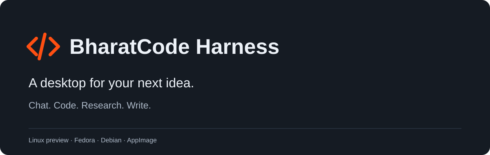

# BharatCode Extensions

Extensions and starter skills for [BharatCode Harness](https://github.com/arzvaak/BharatCode-Harness). Add tools for research, documents, graphics and coding, or build a workflow around your own projects.

[Explore BharatCode](https://arzvaak.github.io/BharatCode-Harness/) · [App downloads](https://github.com/arzvaak/BharatCode-Harness/releases) · [Extension releases](https://github.com/arzvaak/BharatCode-Extensions/releases)

## Included extensions

The app includes BharatCode Providers, Context, Task Board, Library, Code Tools, Skills, Research, Story Continuity, Visuals, Usage and the extension store. Core extensions are bundled with the desktop app. The subscription adapter is bundled separately and requires the relevant provider account.

## Install extensions and skills

Open **Extensions** or **Skills** from the app sidebar. Inspect requirements before installation. Signed catalogs, exact archive checksums and platform qualification determine availability. Optional candidates are shown for discovery and remain unavailable until their packaging and workflow checks pass.

Public releases provide the signed catalog, verified extension archives and managed runtimes. No GitHub account is required for those downloads. This repository stays public because installed builds use these release URLs; private source repositories can distribute through a separate public artifact channel.

Curated source for optional DeepBlend and Three.js/Babylon.js Studio integrations is under `extensions/`; the catalog lists their packages and engine-specific discovery packs. These records remain unavailable until exact platform artifacts and workflow evidence are published. Starter skills are in `skills/`. Add this repository in the Skills sidebar, inspect a skill and install it. The standard `SKILL.md` format is also compatible with other tools.

## App updates

Get the Linux RPM, DEB or AppImage from the [BharatCode app releases](https://github.com/arzvaak/BharatCode-Harness/releases). Current app builds check updates inside the Application menu. Legacy app update files remain here for compatibility. Windows, ARM64 and account-dependent inference are outside the qualified Linux preview.

## Origins and licences

Adapted extensions retain their upstream source links and original licence notices. BharatCode Harness is forked from [DeepSeek Harness](https://github.com/deepseek-ai/deepseek-harness); individual integrations may originate from other projects. See each extension's licence and documentation for its attribution. Product names do not change package identifiers, third-party ownership or qualification status.
